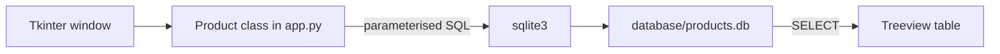

<div align="center">

# Tkinter SQLite Product Manager

**A desktop product manager built with Tkinter and SQLite: add, list, edit and delete products with price, category and stock.**

[](LICENSE)


</div>

Tkinter SQLite Product Manager ("App Gestor de Productos") is a small desktop application for keeping a product catalogue in a local SQLite database. A single window holds a registration form, a table of products and buttons to edit or delete the selected product. The interface is in Spanish.

It is a learning project for practising Tkinter widgets, the `ttk` themed controls and plain `sqlite3` queries with parameters.

## Table of Contents

- [Overview](#overview)
- [Key Features](#key-features)
- [How It Works](#how-it-works)
- [Data Model](#data-model)
- [Tech Stack](#tech-stack)
- [Project Structure](#project-structure)
- [Getting Started](#getting-started)
- [Usage](#usage)
- [Testing](#testing)
- [Status](#status)
- [License](#license)
- [Author](#author)

## Overview

All logic lives in one class, `Product`, in `app.py`. It builds the window, runs SQL against `database/products.db` and refreshes the table after each change. Queries use `?` placeholders, so values typed by the user are passed as parameters rather than concatenated into SQL.

## Key Features

- **Add products** with name, price, category and stock. Each field is required; the app shows an error dialog for missing fields and a confirmation dialog with the saved values.
- **Product table** (`ttk.Treeview`) with name, price, category and stock columns, reloaded from the database after each change.
- **Delete** the selected product, with a status message below the table.
- **Edit** the selected product in a second window that shows the current values as read-only fields next to entry fields for the new ones.
- **Themed look** using the `clam` theme from `ttkthemes`, a custom table font and a window icon.

## How It Works



1. At start-up the `Product` class builds the form, the table and the buttons, and calls `get_products`.
2. `get_products` clears the table and loads all rows of the `product` table, ordered by name.
3. `add_product`, `del_producto` and `actualizar_productos` run `INSERT`, `DELETE` and `UPDATE` statements through `db_query`, which opens a connection, executes the statement and commits.
4. Products are matched for deletion and update by their field values (name, and for updates also price, category and stock).

## Data Model

Table `product` in `database/products.db`:

| Column | Type | Constraints |
|--------|------|-------------|
| `id` | INTEGER | Primary key, auto-increment |
| `name` | TEXT | Not null |
| `price` | REAL | Not null |
| `categorize` | TEXT | Not null (holds the category) |
| `stock` | REAL | Not null |

## Tech Stack

| Area | Technology |
|------|------------|
| Language | Python 3 |
| GUI | Tkinter and `tkinter.ttk` (standard library) |
| Themes | `ttkthemes` (`ttkthemes~=3.2.2`) |
| Database | SQLite through the standard `sqlite3` module |

## Project Structure

```text
tkinter_sqlite_project/
├── LICENSE
├── README.md
├── requirements.txt       # ttkthemes
├── app.py                 # The whole application
├── productos.csv          # Header row only (Nombre, Precio, Categoría, Stock)
├── recursos/
│   └── icon.ico           # Window icon
└── database/
    └── products.db        # SQLite database with the product table
```

## Getting Started

### Prerequisites

- Python 3 with Tkinter. Tkinter ships with the standard Windows and macOS installers; on some Linux distributions install it separately (for example the `python3-tk` package).
- The `ttkthemes` package.
- Windows is the expected platform: the code calls `wm_iconbitmap` with an `.ico` file, which is a Windows-oriented feature and may fail on other systems.

### Installation

```bash
git clone https://github.com/LargoLujan/tkinter_sqlite_project
cd tkinter_sqlite_project
python -m venv .venv
```

Activate the virtual environment:

```bash
# Windows (PowerShell)
.\.venv\Scripts\Activate.ps1

# macOS / Linux
source .venv/bin/activate
```

Install the dependencies:

```bash
pip install -r requirements.txt
```

### Configuration

There is no configuration file or environment variable. The database path (`database/products.db`) and the icon path (`recursos/icon.ico`) are relative, so start the app from the repository root.

### Running

```bash
python app.py
```

## Usage

1. Fill in Nombre, Precio, Categoría and Stock in the "Registro de un nuevo Producto" box and press "Guardar Producto". A dialog confirms the saved values and the table refreshes.
2. Select a row in the table and press "Eliminar" to delete it, or "Editar" to open the edit window.
3. In the edit window, fill in the new values and press "Actualizar Producto". The update is applied in three cases: all four new fields filled in; only the new name; or only the new price. Any other combination closes the window and reports that the product was not updated.

## Testing

There are no automated tests.

## Status

| Area | State |
|------|-------|
| Add, list, delete | Working as written |
| Edit | Supports the three combinations described above; the table is refreshed afterwards |
| Input validation | Only checks that fields are not empty; price and stock are not checked to be numbers |
| `productos.csv` and the `csv` import | Present, but the file only has a header row and nothing in the code reads or writes it |

## License

Distributed under the MIT License. See [LICENSE](LICENSE) for details.

## Author

**Manuel Luján Vílchez** — Senior Data Engineer

[](https://github.com/LargoLujan)
[](https://www.linkedin.com/in/manuel-lujan-vilchez)
